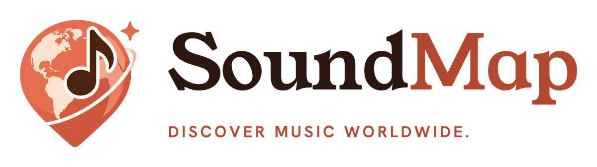

<p align="center"></p>

**SoundMap** is an ethnomusicology learning app that starts with your ears. You hear a sound from somewhere on Earth, guess where it's from on a map, and earn passport stamps. Then you meet the people who made it.

Built for the Congressional App Challenge.

## Run it on your phone

You need Node 20.19.4 or newer ([nvm](https://github.com/nvm-sh/nvm) reads `.nvmrc`) and the **Expo Go** app on your phone (App Store or Google Play).

```bash
nvm use
npm install
npx expo start
```

Scan the QR code: on iPhone use the Camera app, on Android use Expo Go. If your phone and computer are on different networks, run `npx expo start --tunnel` instead.

## Android APK

An installable APK is built with EAS (profile `preview` in `eas.json`):

```bash
npx eas-cli@latest build -p android --profile preview
```

[APK download link]

## Website

The storytelling site is plain HTML, CSS and JavaScript in `website/`, with no build step. To preview it locally:

```bash
cd website && python3 -m http.server 8080
```

Deploy it on Render as a Static Site: leave the build command empty and set the publish directory to `website`.

## What's inside

- **Play:** eight "where in the world?" rounds, scored by region, distance and speed, with a flight arc to the answer.
- **Lessons:** 19 listening lessons across 5 regions, with layer mixers, ear challenges and route maps. There's also a musical family tree.
- **Learn:** quizzes (text, audio and map questions), spaced-review flashcards, and "explain it back" practice.
- **Trending:** short editorial stories with cultural and historical context.
- **SoundDeck:** pads, a 16-step sequencer, a keyboard, five unlockable packs, and a Rhythm Coach that judges your timing.

## Tech

- Expo SDK 54 and React Native 0.81, written in TypeScript, with expo-router.
- Sound comes from our own synthesizer (`scripts/synth/`, Node, no dependencies), which renders every instrument. One engine (`src/audio/SoundEngine.ts`, expo-audio) plays everything on a drift-corrected step clock.
- The map is Natural Earth 110m in the Equal Earth projection, generated by `scripts/build-map.mjs`. d3-geo draws the great-circle arcs, so no map SDK or API key is needed.
- Lesson data is generated from `docs/content/lessons.json` by `scripts/build-lessons.mjs`.

Regenerate generated files with `npm run build:map`, `npm run build:lessons` and `npm run synth`.

## Credits

- Lesson content, research and design by the student developer.
- Every sound is synthesized by SoundMap's own code: no third-party recordings.
- People in the lessons are shown as typographic portrait cards. There are no photographs of real people.
- Map data: [Natural Earth](https://www.naturalearthdata.com/) via [world-atlas](https://github.com/topojson/world-atlas) (public domain).
- Fonts: Young Serif, Hanken Grotesk and DM Mono (SIL Open Font License).
- Icons: [Phosphor](https://phosphoricons.com/) (MIT), plus a custom instrument glyph set.
